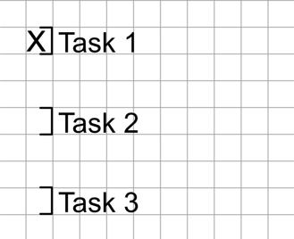
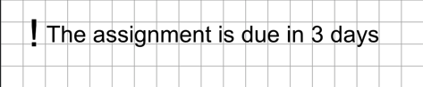
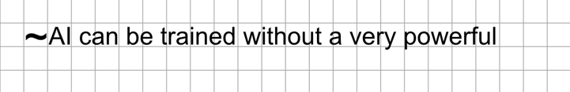

> [Home](../../README.md) • [1. Introduction](../Introduction.md) • [2. Basic Concepts](Basic-Concepts.md) • [3. Advanced Concepts](Advanced-Concepts.md) • [4. Structure and Format](Structure-and-Format.md) • **5. Additional Symbols** • [6. Real Examples](../Real-Examples/README.md)

---

# 5. Additional Symbols

In addition to structural and reading-priority symbols, Gray Notation includes auxiliary markers designed for active study management: tracking pending tasks, reminders, and flagging doubts.

## 1. To-Do List (`]`)

The symbol `]` is used at the beginning of a block to indicate a pending task, an exercise to solve, or a concrete action item derived from the lesson.

## 2. Reminder (`!`)

The symbol `!` is used to highlight important administrative or academic information that must be remembered (such as exam dates, deadlines, recommended reading, or key warnings from the instructor).

## 3. Doubt (`~`)

The symbol `~` is used to indicate that a block contains a doubtful statement, a concept that was not entirely clear during the explanation, or information that requires subsequent verification.

---

**Navigation:** [← Previous: 4. Structure and Format](Structure-and-Format.md) | [Next: 6. Real Examples →](../Real-Examples/README.md)
