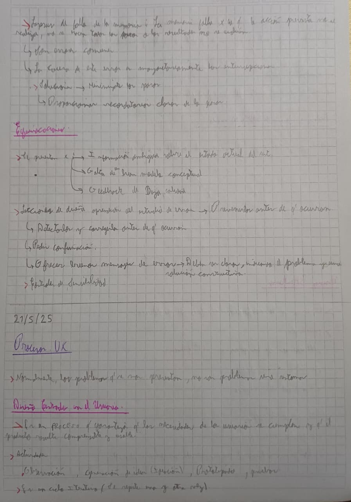
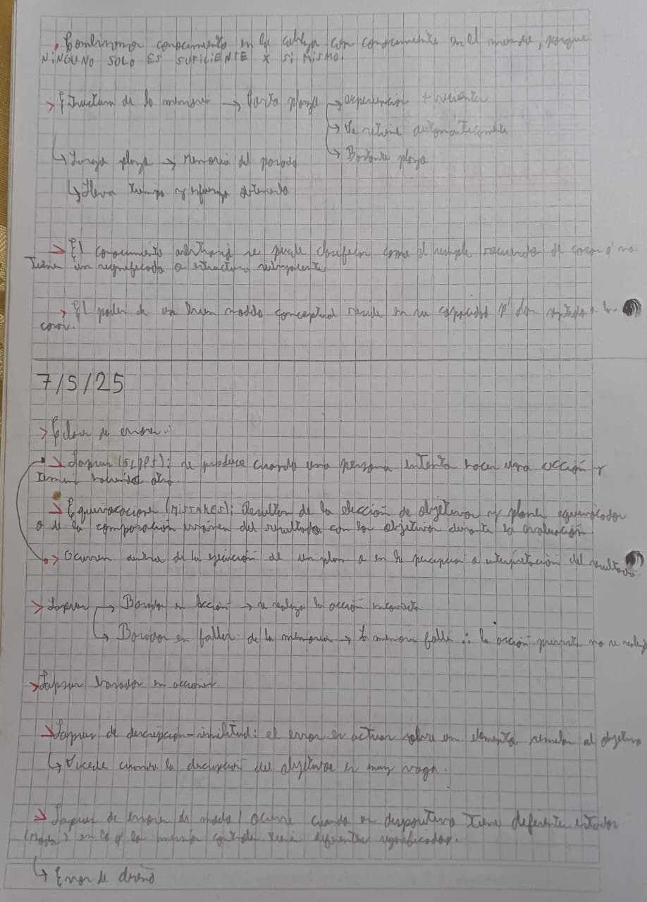
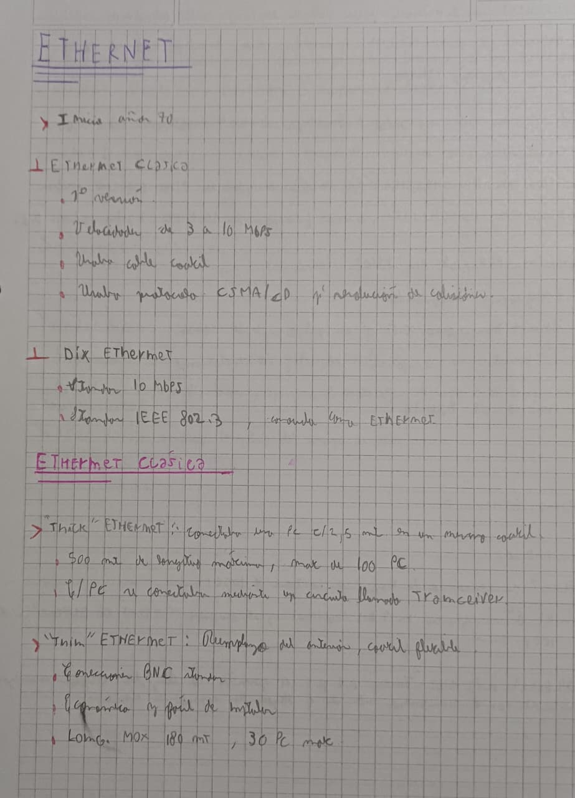

> [Home](../../README.md) • [1. Introduction](../Introduction.md) • [2. Basic Concepts](../Documentation/Basic-Concepts.md) • [3. Advanced Concepts](../Documentation/Advanced-Concepts.md) • [4. Structure and Format](../Documentation/Structure-and-Format.md) • [5. Additional Symbols](../Documentation/Additional-Symbols.md) • **6. Real Examples**

---

# 6. Real Examples in Practice

This section showcases real-world university notes taken live using **Gray Notation**. The goal is to demonstrate how the system preserves legibility and hierarchical structure under real classroom conditions, regardless of handwriting speed.

---

## Example 1

---

## Example 2

---

## Example 3

---

**Navigation:** [← Previous: 5. Additional Symbols](../Documentation/Additional-Symbols.md) | [Back to Home](../../README.md)
