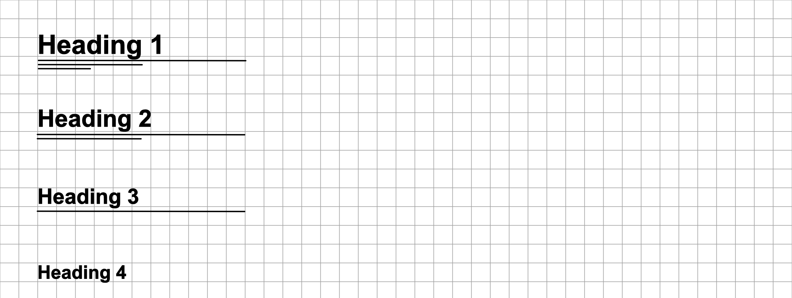
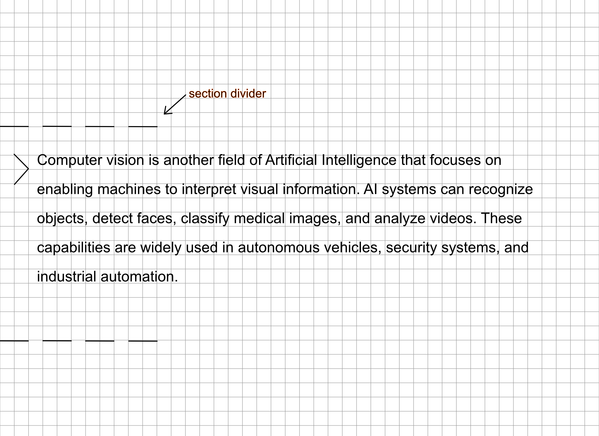
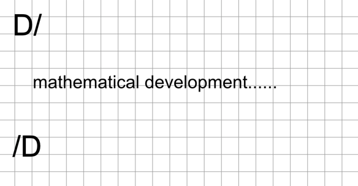
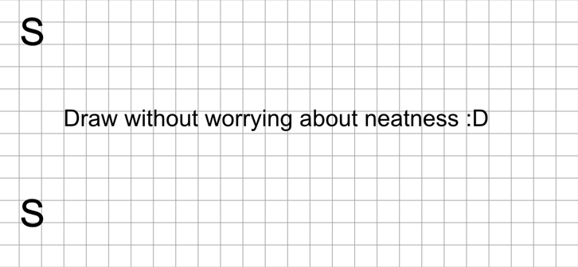

> [Inicio](../../README.md) • [1. Introducción](../Introduccion.md) • [2. Conceptos Básicos](Conceptos-Basicos.md) • [3. Conceptos Avanzados](Conceptos-Avanzados.md) • **4. Estructura y Formato** • [5. Símbolos Adicionales](Simbolos-Adicionales.md) • [6. Ejemplos Reales](../Ejemplos-Reales/README.md)

---

# 4. Estructura y Formato de la Página

Hasta ahora, hemos visto cómo Gray Notation utiliza símbolos para organizar la información a nivel "micro" (bloque por bloque). Sin embargo, para que un cuaderno sea verdaderamente legible, también necesitamos organizar la información a nivel "macro": **la estructura de la página**.

Esta sección detalla convenciones visuales para separar grandes bloques temáticos y establecer jerarquías de títulos utilizando únicamente tu bolígrafo, sin necesidad de recurrir a marcadores, colores o letras exageradamente grandes.

## 1. Jerarquía de Títulos (Headings)

Para diferenciar visualmente un tema principal de un subtema, Gray Notation propone un sistema de **subrayado progresivo**. Esto permite que el ojo identifique rápidamente la estructura del documento al hojear las páginas.

> [!tip]
> Mantener un espaciado consistente (por ejemplo, dejar siempre un renglón en blanco o dos cuadros antes y después de un Heading 1 y 2) potenciará enormemente el efecto visual de esta jerarquía.

## 2. Separadores de Sección

Durante una clase, es común que ocurran saltos radicales de tema, o que simplemente termine una clase y la siguiente comience en la mitad de la misma hoja.

Para evitar que la información de contextos distintos se mezcle visualmente, utilizamos el **Separador de Sección**.

Consiste en trazar una **línea discontinua o punteada** (`- - - - -`) horizontal que atraviese parte o la totalidad del ancho de la zona de escritura.

## 3. Sección de Desarrollo Matemático

Las fórmulas extensas, los cálculos escalonados y las demostraciones de teoremas pueden romper el ritmo visual de los apuntes teóricos.

Delimitar explícitamente una **Zona de Desarrollo Matemático** te permite agrupar todo el contenido procedimental (números y ecuaciones) separado del contenido conceptual (el texto que explica esas ecuaciones).

## 4. Pizarra Libre

Al delimitar un cuadro en tu hoja y etiquetarlo como **"Pizarra Libre"**, te estás dando el permiso explícito para hacer bocetos, diagramas rápidos o anotaciones informales en esa área específica, sin sentir que has arruinado la estética o estructura general de tus apuntes.

---

**Navegación:** [← Anterior: 3. Conceptos Avanzados](Conceptos-Avanzados.md) | [Siguiente: 5. Símbolos Adicionales →](Simbolos-Adicionales.md)
