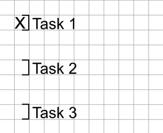
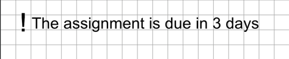
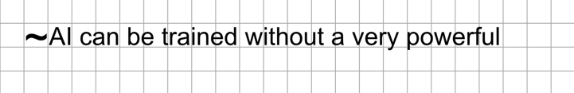

> [Inicio](../../README.md) • [1. Introducción](../Introduccion.md) • [2. Conceptos Básicos](Conceptos-Basicos.md) • [3. Conceptos Avanzados](Conceptos-Avanzados.md) • [4. Estructura y Formato](Estructura-y-Formato.md) • **5. Símbolos Adicionales** • [6. Ejemplos Reales](../Ejemplos-Reales/README.md)

---

# 5. Símbolos Adicionales

Además de los símbolos estructurales y de prioridad de lectura, Gray Notation incorpora marcadores auxiliares pensados para la gestión activa del estudio: seguimiento de pendientes, recordatorios y validación de dudas.

## 1. Lista de Tareas (`]`)

Se utiliza el símbolo `]` al inicio del bloque para indicar una tarea pendiente, un ejercicio por resolver o una acción concreta derivada de la clase.

## 2. Recordatorio (`!`)

Se utiliza el símbolo `!` para señalar información administrativa o académica importante que debe recordarse (como fechas de exámenes, entregas, bibliografía recomendada o advertencias del profesor).

## 3. Duda (`~`)

Se utiliza el símbolo `~` para indicar que un bloque contiene una afirmación dudosa, un concepto que no quedó del todo claro durante la explicación o un dato que requiere verificación posterior.

---

**Navegación:** [← Anterior: 4. Estructura y Formato](Estructura-y-Formato.md) | [Siguiente: 6. Ejemplos Reales →](../Ejemplos-Reales/README.md)
