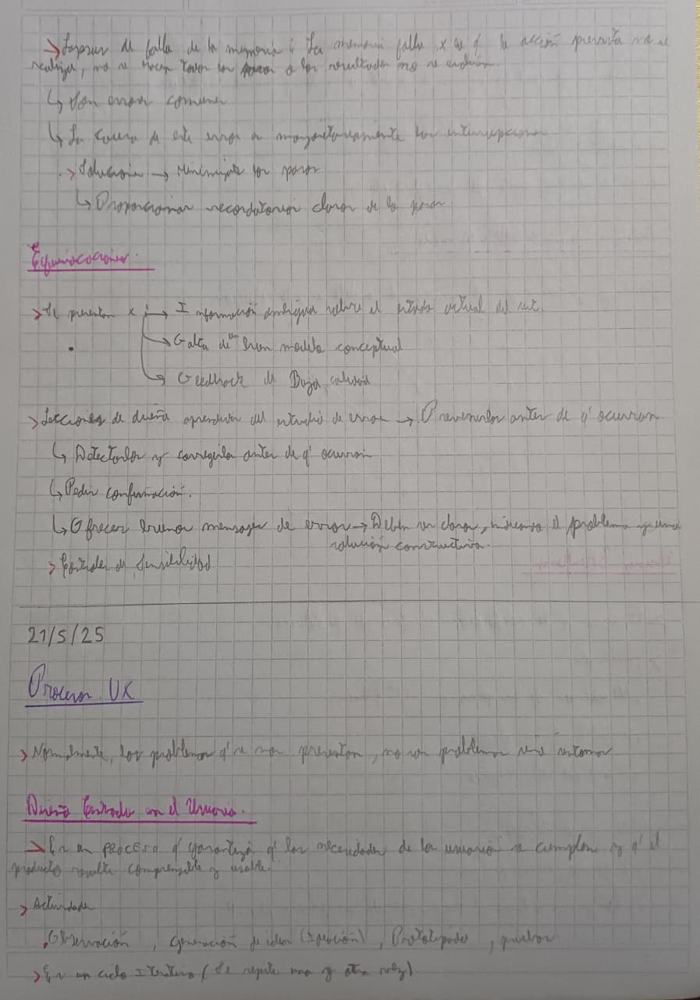
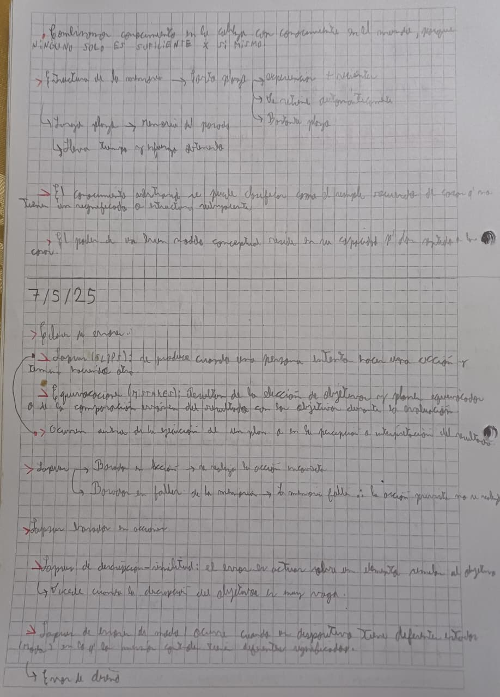
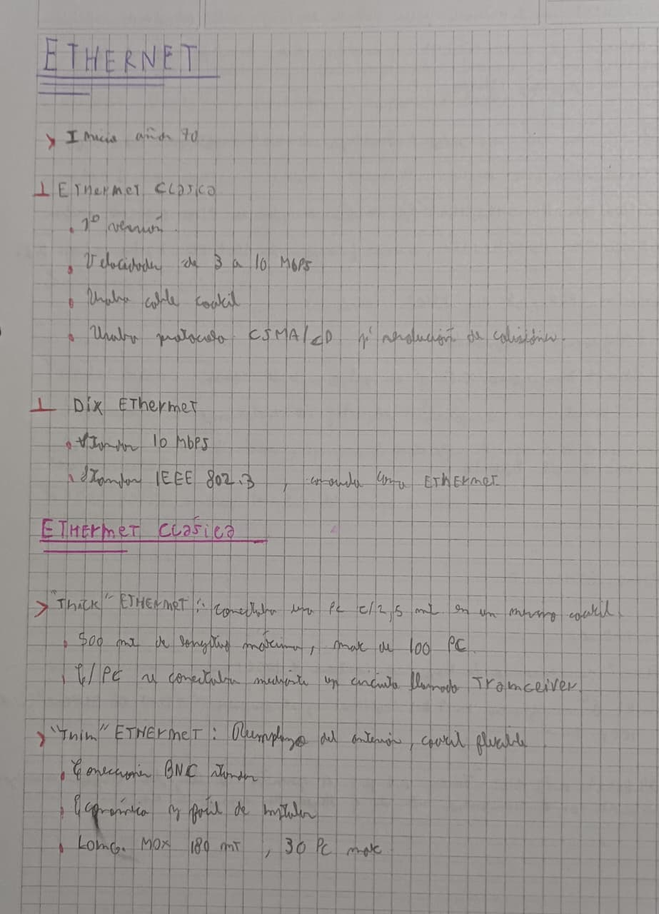

> [Inicio](../../README.md) • [1. Introducción](../Introduccion.md) • [2. Conceptos Básicos](../Documentacion/Conceptos-Basicos.md) • [3. Conceptos Avanzados](../Documentacion/Conceptos-Avanzados.md) • [4. Estructura y Formato](../Documentacion/Estructura-y-Formato.md) • [5. Símbolos Adicionales](../Documentacion/Simbolos-Adicionales.md) • **6. Ejemplos Reales**

---

# 6. Ejemplos Reales en Práctica

En esta sección se presentan casos reales de apuntes universitarios tomados en directo utilizando **Gray Notation**. El objetivo es demostrar cómo el sistema mantiene su legibilidad y estructura jerárquica en condiciones reales de clase, más allá de la caligrafía o velocidad de escritura.

---

## Ejemplo 1

---

## Ejemplo 2

---

## Ejemplo 3

---

**Navegación:** [← Anterior: 5. Símbolos Adicionales](../Documentacion/Simbolos-Adicionales.md) | [Volver al Inicio](../../README.md)
